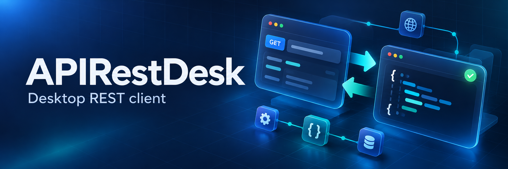
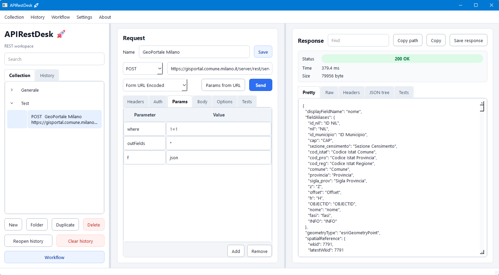
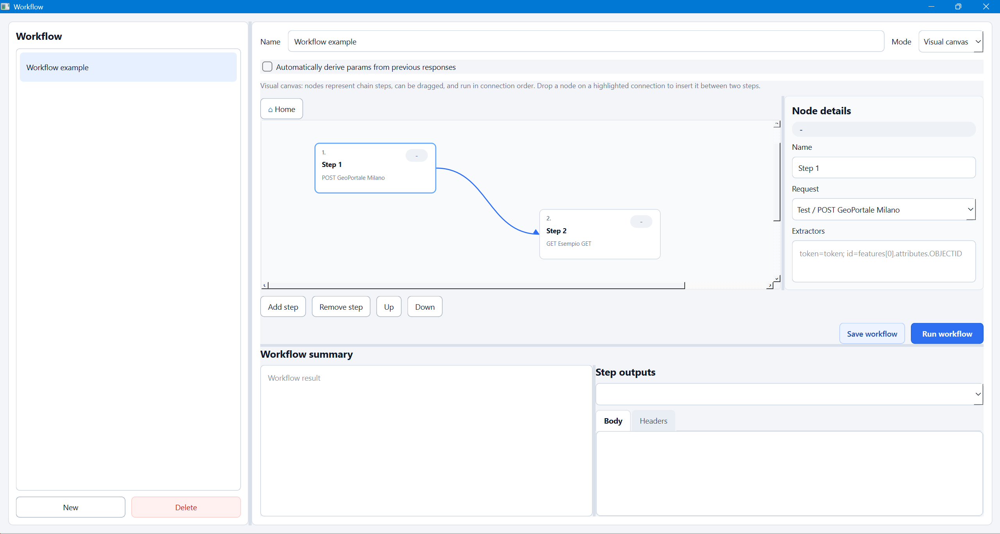

<p align="center">
  
</p>

<p align="center">
  <strong>A simple desktop workspace for REST APIs.</strong><br />
  Requests · Environments · Visual workflows
</p>

<p align="center">
  <a href="https://github.com/GiancaGIS/APIRestDesk/releases/latest"></a>
  <a href="#installation"></a>
  
  <a href="LICENSE"></a>
</p>

<p align="center">
  Windows · macOS · Linux<br />
  <a href="https://github.com/GiancaGIS/APIRestDesk/releases/latest">Download</a> ·
  <a href="#installation">Getting started</a> ·
  <a href="#environments">Environments</a> ·
  <a href="#workflow-composer">Workflow composer</a>
</p>

---

APIRestDesk is a PyQt6 desktop REST client for collecting, testing, saving, and composing REST calls. It is designed as a lightweight tool with local persistence, request history, authentication helpers, and visual workflow composition.

## Screenshots

### Main Window



### Workflow Composer



## Highlights

- Local REST request collection organized in folders.
- Persistent request history.
- HTTP methods: `GET`, `POST`, `PUT`, `PATCH`, `DELETE`.
- Async HTTP execution with `httpx`, keeping the GUI responsive.
- Request editor for URL, headers, params, auth, and body.
- Suggested common HTTP headers.
- Auth modes: no auth, Basic Auth, Bearer Token, API Key in header or query string.
- Query params editor with key/value rows.
- Body modes: `Raw`, `JSON`, `Form URL Encoded`.
- Per-request options for timeout, redirect following, and HTTP status retries.
- Optional session cookies shared across requests.
- Response tests/assertions for status, time, headers, body text, and JSON paths.
- Import OpenAPI JSON documents as request collections.
- Import from cURL and copy the current request as cURL.
- Workspace import/export including collection, folders, history, workflows, and settings.
- Named environments with reusable `{{variable}}` placeholders and a visible environment selector.
- Cancel running requests and workflows, retaining completed workflow steps.
- JSON formatting with built-in validation.
- Response viewer with `Pretty`, `Raw`, `Headers`, JSON tree, tests, search, copy, and save.
- Status badges and colors for HTTP results.
- Toast notifications in the top-right corner.
- Light and dark themes.
- Italian/English language setting.
- `About` menu with the application version.
- Automatic GitHub release checks, with an optional manual check.

## Environments

The **Active environment** selector in the request editor and workflow composer chooses the variables used for execution. The selectors stay synchronized. The default environments are **Development**, **Test**, and **Production**; in **Settings**, you can add, rename, delete, and edit environments. At least one environment is retained. Changes in the settings dialog are saved only when you press **OK**.

Use placeholders such as `{{base_url}}` and `{{token}}` in URLs, headers, query parameters, authentication fields, and request bodies, including form bodies. Existing global variables are migrated automatically to **Development**. Undefined variables in fields that will be sent block the request and display an error. Disabled query parameters do not require values. Workflow variables extracted by earlier steps can satisfy placeholders in later steps.

Each execution uses a snapshot of its request options and variables. Switching environments while a workflow runs affects subsequent executions. Workspace exports include all named environments and the selected environment.

## Cancelling Execution

While a request runs, **Send** is replaced by **Cancel**. Use **Cancel** or **Cancel workflow** to interrupt an execution, including network waits and pauses between retry attempts. Cancelled standalone requests do not create a history entry. Workflow cancellation preserves the results and variables of completed steps, and prevents remaining steps from running. The workflow summary also identifies the environment used for execution.

Closing the main window or workflow composer cancels active request/workflow operations and waits for their cleanup before closing. Cancelling an HTTP request cannot undo operations the server has already performed.

## Updates

APIRestDesk checks the latest stable release from `GiancaGIS/APIRestDesk` on GitHub shortly after startup and every 6 hours while the app is running. Checks run in the background; connection failures during automatic checks do not interrupt your work. Disable automatic checks in **Settings**, or use **About → Check for updates** at any time.

When a newer version is available, an alert shows the installed and available versions. **Open release** opens the release page in your browser, where you can download the appropriate installer or bundle. Installation is performed by the user. The same version is announced only once per app session during automatic checks.

Release checks use the public GitHub API without credentials and ignore drafts and prereleases. Publish a stable GitHub release with a numeric tag such as `v1.0.5` or `1.0.5` (two to four numeric components; optional `+build` metadata). Keep `APP_VERSION` in `api_rest_desk/config.py` and the version in `pyproject.toml` aligned with the packaged release. Tags without a published release do not trigger updates.

## Workflow Composer

The workflow composer chains saved REST calls. Each step executes a saved request and can extract values from its JSON response for use in following steps.

Available workflow modes:

- **Linear**: table-based step editor.
- **Visual canvas**: draggable nodes with connections.

The workflow window can be maximized. The result area has a vertical splitter, so the lower output panel can be resized. After a workflow run, APIRestDesk shows:

- a workflow summary with extracted variables, status codes, timings, and response sizes;
- each step's response body and headers;
- status badges on blocks or canvas nodes.

### Extracting Values From JSON

In the `Extractors` field, use:

```text
variable_name=json.path
```

Example response:

```json
{
  "token": "ABC123",
  "features": [
    {
      "attributes": {
        "OBJECTID": 10
      }
    }
  ]
}
```

Extractors:

```text
token=token; object_id=features[0].attributes.OBJECTID
```

Following steps can use those variables with:

```text
{{token}}
{{object_id}}
```

Examples:

```text
Authorization: Bearer {{token}}
```

```text
token={{token}}
```

```text
where=OBJECTID={{object_id}}
```

Do not write `{{token}}` inside the `Extractors` field. Curly-brace variables are used only when consuming an extracted value in later steps.

### Automatic Parameter Mapping

In a workflow, enable `Automatically derive params from previous responses` to fill blank query parameters in following steps from JSON fields returned by earlier steps. APIRestDesk first tries an exact name match, then a similarity score for common variants such as `userId`, `user_id`, and `user-id`.

Automatic mapping does not overwrite non-empty parameter values. Manually configured extractors still have priority for explicit `{{variable}}` usage.

## Local Data Files

During development, data is stored as JSON files in the project root. In packaged builds, data is stored in the current user's application data folder:

- Windows: `%APPDATA%\APIRestDesk`
- macOS: `~/Library/Application Support/APIRestDesk`
- Linux: `$XDG_DATA_HOME/APIRestDesk` or `~/.local/share/APIRestDesk`

The data files are:

- `rest_client_collection.json`: saved request collection.
- `rest_client_folders.json`: collection folders.
- `rest_client_history.json`: request history.
- `rest_client_workflows.json`: saved workflows.
- `rest_client_settings.json`: language, theme, and settings.
- `rest_client_cookies.json`: optional session cookie jar.

The history limit is configured in `api_rest_desk/config.py`:

```python
HISTORY_LIMIT = 250
```

## Installation

Requirements:

- Python 3.11 or newer.
- Windows, Linux, or macOS with PyQt6 support.

Install runtime dependencies:

```powershell
.\.venv\Scripts\python.exe -m pip install -r requirements.txt
```

Install the project in editable mode:

```powershell
.\.venv\Scripts\python.exe -m pip install -e .
```

## Running

Direct launcher:

```powershell
.\.venv\Scripts\python.exe launch_api_rest_desk.py
```

Python module:

```powershell
.\.venv\Scripts\python.exe -m api_rest_desk
```

Installed entry point:

```powershell
.\.venv\Scripts\api-rest-desk.exe
```

## Packaging

The project includes a `pyproject.toml` with:

- package name: `api-rest-desk`
- version: `1.0.3`
- dependencies: `PyQt6`, `httpx`
- entry point: `api-rest-desk = api_rest_desk.__main__:main`

Build a Python distribution:

```powershell
.\.venv\Scripts\python.exe -m pip install build
.\.venv\Scripts\python.exe -m build
```

### Desktop App And Installers

The application icon source is `api_rest_desk/assets/app_icon.svg`. The `png`, `ico`, and `icns` files in the same folder are generated from that vector source for runtime, Windows, and macOS packaging.

Regenerate all icon formats after editing the SVG:

```powershell
.\.venv\Scripts\python.exe scripts/generate_icon_assets.py
```

The script uses the existing PyQt6 dependency. The README banner is stored in `images/readme_banner.png`; its generation brief is recorded in [images/branding.md](images/branding.md).

Install the packaging dependencies:

```powershell
.\.venv\Scripts\python.exe -m pip install -e ".[packaging]"
```

Build the Windows app folder and Inno Setup installer:

```powershell
.\scripts\build_windows.bat
```

The Windows script writes:

- `dist\APIRestDesk\APIRestDesk.exe`
- `dist\installer\APIRestDesk-1.0.5-Setup.exe`
- `dist\release\`: matching source ZIPs, dependency source ZIP, binary ZIP, installer, release notes and checksums.

The Inno Setup wizard supports both install modes:

- all users, under `C:\Program Files\APIRestDesk` when elevated;
- current user, under the user's profile when not elevated.

Build only the PyInstaller app folder without Inno Setup:

```powershell
.\scripts\build_windows.bat --skip-installer
```

Build the macOS `.app` bundle on macOS:

```bash
bash scripts/build_macos.sh
```

The macOS script writes `dist/APIRestDesk.app` and prepares release/source archives under `dist/release/`.

## Project Structure

```text
api_rest_desk/
  __main__.py              Package entry point
  config.py                App constants, version, data file paths
  environment_selector.py  Shared active-environment selector
  http_client.py           httpx-based HTTP wrapper
  i18n.py                  Italian/English translations
  main_window.py           Main PyQt6 window
  models.py                Dataclasses for requests, history, workflows
  settings.py              Settings persistence
  settings_dialog.py       Settings dialog
  storage.py               Local JSON read/write helpers
  theme.py                 Light/dark theme and status badges
  toast.py                 Animated toast notifications
  updates.py               GitHub release lookup and version comparison
  widgets.py               Reusable widgets: headers, auth, key/value
  workers.py               Qt workers for HTTP and workflow execution
  workflow.py              Workflow engine, templating, JSON path extraction
  workflow_canvas.py       Visual workflow canvas
  workflow_dialog.py       Workflow composer
```

Root files:

```text
launch_api_rest_desk.py    Desktop launcher
pyproject.toml             Python packaging metadata
requirements.txt           Runtime dependencies
README.md                  Documentation
```

## Technical Notes

- HTTP requests run in Qt worker threads.
- History stores request headers, params, body, request options, assertions, status, response headers, and response body.
- TLS certificate verification defaults to enabled for legacy requests and is preserved by duplication, editor imports, and history restore. History also preserves disabled query parameter rows.
- Auth credentials are stored in the local request collection.
- History entries do not restore auth credentials, to avoid duplicating tokens/passwords.
- Session cookies are stored only when a request has the session-cookie option enabled.
- Workflows reference saved collection requests. If a request changes, workflow steps use the updated request.
- The `{{variable}}` template is applied to URLs, headers, body, params, and auth fields.
- Extractors read JSON responses with paths such as `token`, `data.access_token`, `features[0].attributes.OBJECTID`.
- Retries are evaluated on configured HTTP statuses such as `429`, `500`, `502`, `503`, and `504`.
- cURL import currently supports the common request options: URL, method, headers, raw data, Basic Auth, redirects, and timeout.
- OpenAPI import currently supports JSON documents, OpenAPI 3 `servers`, Swagger 2 `host/basePath`, paths, methods, query/header parameters, and basic JSON/form request body examples.

## Response Tests

The request `Tests` tab supports one assertion per line:

```text
status == 200
time < 1000
body contains success
header Content-Type contains json
json token exists
json data.items[0].id == 10
```

Assertions run after the response arrives. Results are shown in the response `Tests` tab and saved in history.

## License and source code

APIRestDesk is distributed under the **GNU General Public License, version 3 only** (GPL-3.0-only). Copyright (c) 2026 GiancaGIS. You may use, modify, and redistribute it under that license, including commercially. It comes without warranty. See [LICENSE](LICENSE) and [COPYRIGHT](COPYRIGHT).

Dependency licenses and copyright notices remain applicable: see [THIRD_PARTY_NOTICES.md](THIRD_PARTY_NOTICES.md). Copies previously released under MIT retain their original permissions; the previous notice is preserved in [licenses/APIRestDesk-MIT-prior.txt](licenses/APIRestDesk-MIT-prior.txt).

Each binary release must provide its matching application source archive and dependency source archives, with clear download instructions beside the installer. See [SOURCE_CODE.md](SOURCE_CODE.md) for source access, rebuilding, and replacing Qt libraries, and [packaging/RELEASING.md](packaging/RELEASING.md) for the release procedure.

## Disclaimer

The software is distributed on an "AS IS" BASIS, WITHOUT WARRANTIES OR CONDITIONS OF ANY KIND, either express or implied.
